  <!-- Animated Cyberpunk 2077 Glitch & HUD Hero Banner -->
  

   

  <!-- Animated Neon Terminal Typing Effect -->
  

   

  <!-- Profile Status Badges -->
  
  
  

 

 

<!-- Animated Cyberdeck Terminal & Breach Protocol -->

  

 

 

<!-- Featured Project Showcase -->
<h2 align="center">⚡ FEATURED ARCHIVE // EXECUTABLE ⚡</h2>

  

 

 

<!-- Cyberware / Tech Stack -->
<h2 align="center">🦾 INSTALLED CYBERWARE // TECH ARSENAL 🦾</h2>

  <h3>🎮 Systems & Game Development</h3>
  

    
    
    
    
    
  

  <h3>🌐 Web & Scripting</h3>
  

    
    
    
    
    
    
  

  <h3>🗄️ Data & Databases</h3>
  

    
    
  

 

 

<!-- Live GitHub Telemetry -->
<h2 align="center">📡 NIGHT CITY TELEMETRY // LIVE STATS 📡</h2>

  
  

 

  

 

  

 

 

<!-- Comms Link -->
<h2 align="center">🛰️ ESTABLISH COMMS LINK 🛰️</h2>

  
  

 

<!-- Animated Cyberpunk Footer -->

  

